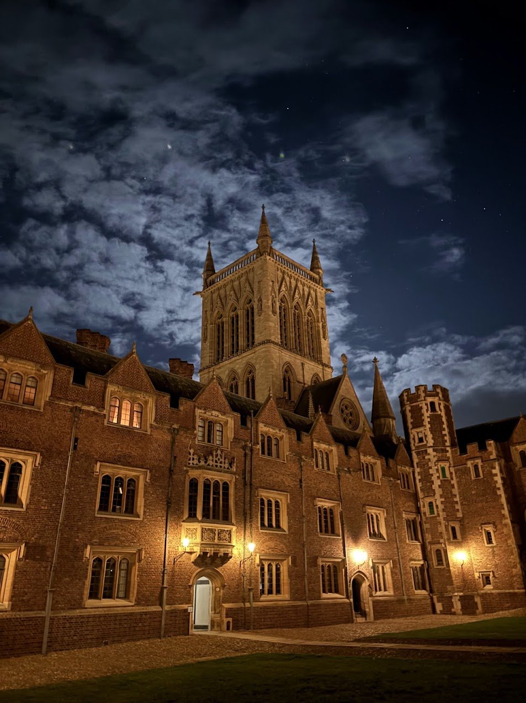
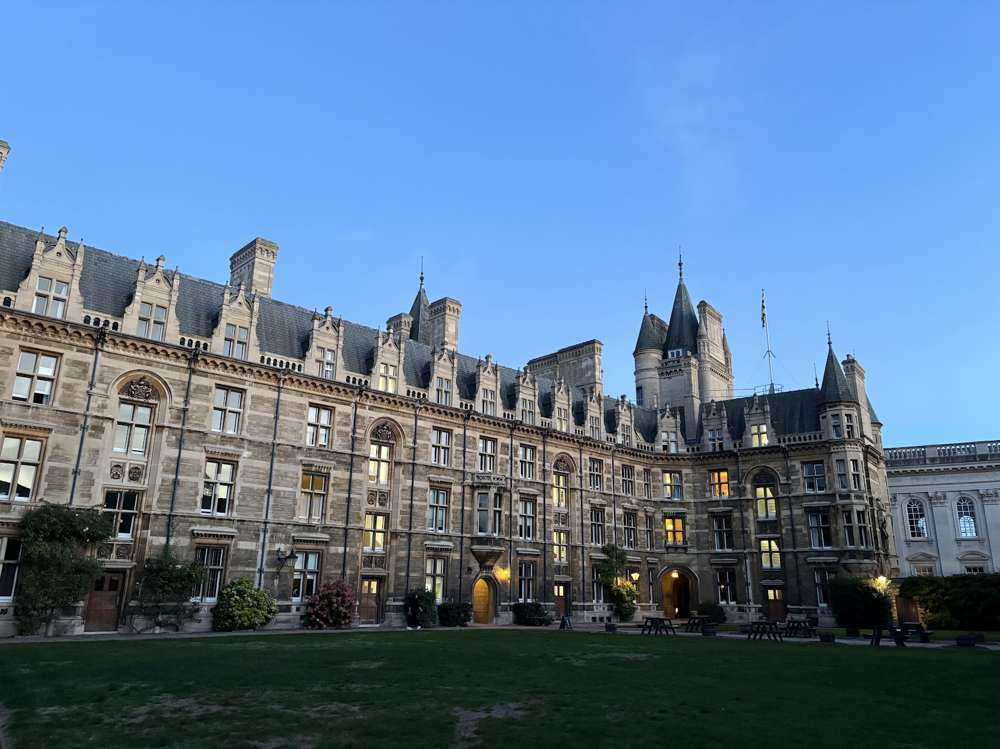

This is the [cosmology meeting]((https://indico.physik.uni-muenchen.de/event/717/overview)) in between Munich region and Cambridge. This Cambridge-LMU Cosmology Meeting lasts from 2026-09-29 to 2026-10-01. My topic is about _**Probe Parity Violation with Weak Lensing Trispectrum**_

This is my first time in UK, really enjoy!

Had dinner at St John's College

Also visited Caius College!

